

  <a href="https://portfolio-irfanafifi.vercel.app"></a>

  
  <a href="https://linkedin.com/in/irfanafifiromzi"></a>
  

  I build the whole stack: <b>NestJS</b> and <b>Spring Boot</b> APIs, <b>React Native</b> apps on both stores, 
  <b>Vue</b> and <b>React</b> dashboards, and <b>ESP32 + RFID</b> hardware that talks to all of it. 
  After hours I make strange little things with <b>three.js</b> and <b>Blender</b>.

 

  <a href="https://portfolio-irfanafifi.vercel.app/work/feelings-vending-co">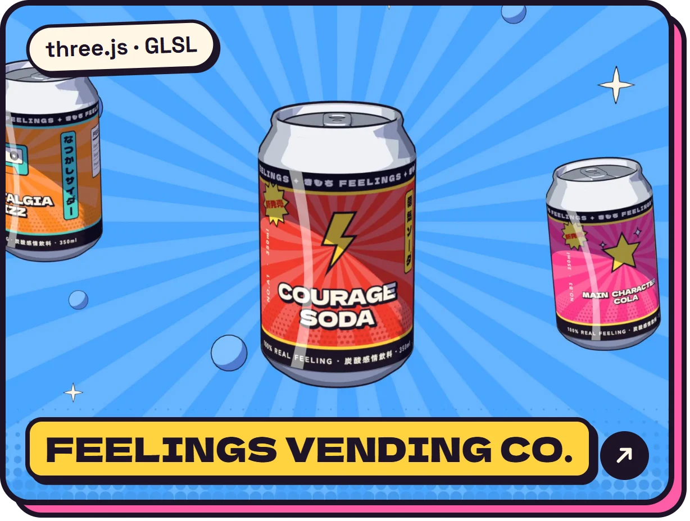</a>
  <a href="https://portfolio-irfanafifi.vercel.app/work/evolve-technology-website">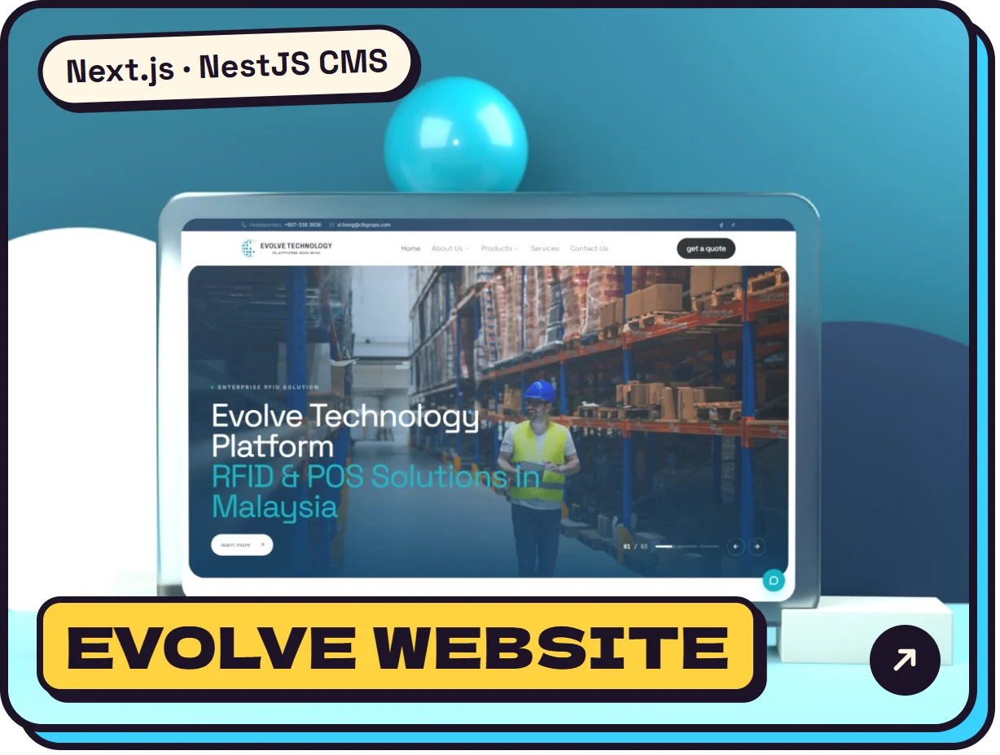</a>

  <a href="https://portfolio-irfanafifi.vercel.app/work/happi-malaysia-insurance">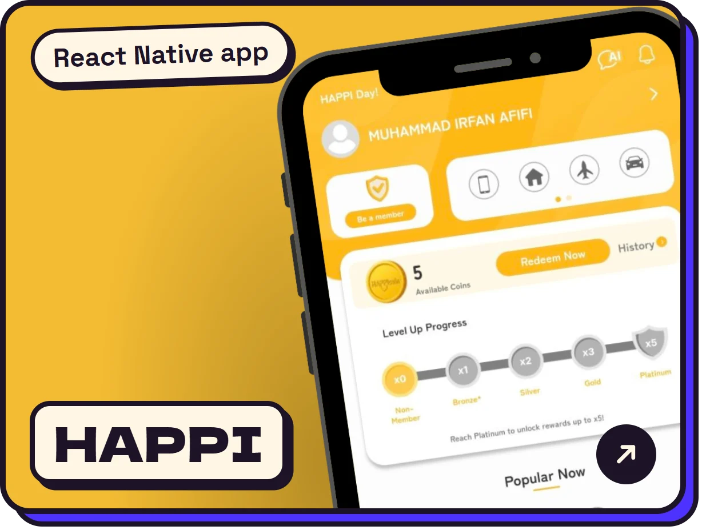</a>
  <a href="https://portfolio-irfanafifi.vercel.app/work/zora-pro-erp">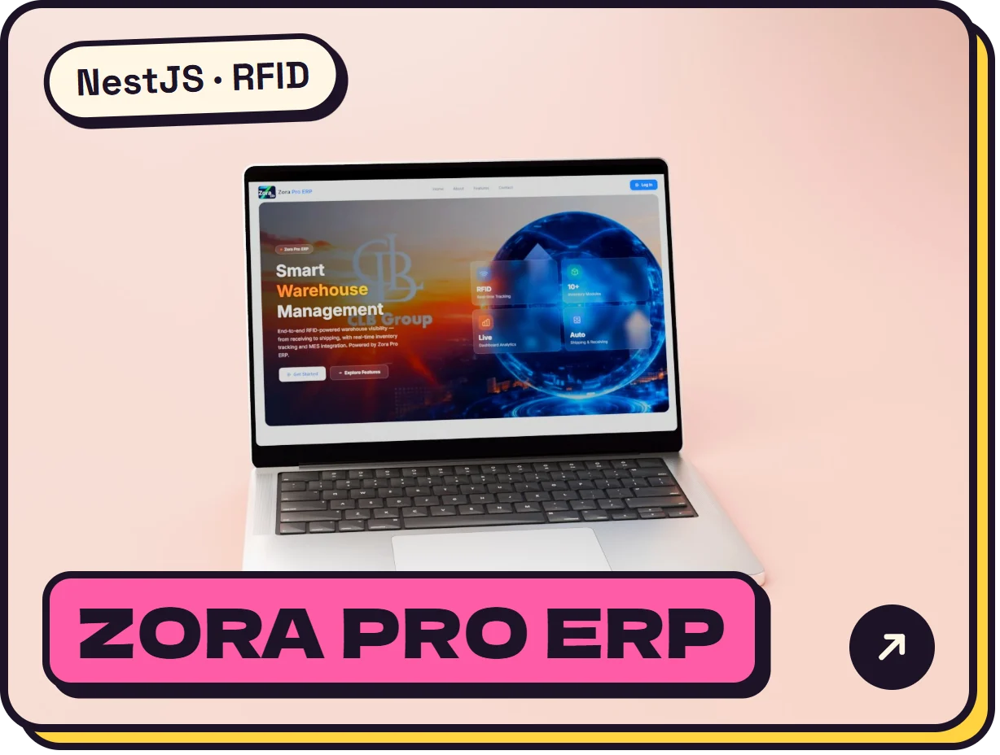</a>
  <a href="https://portfolio-irfanafifi.vercel.app/work/gvreport">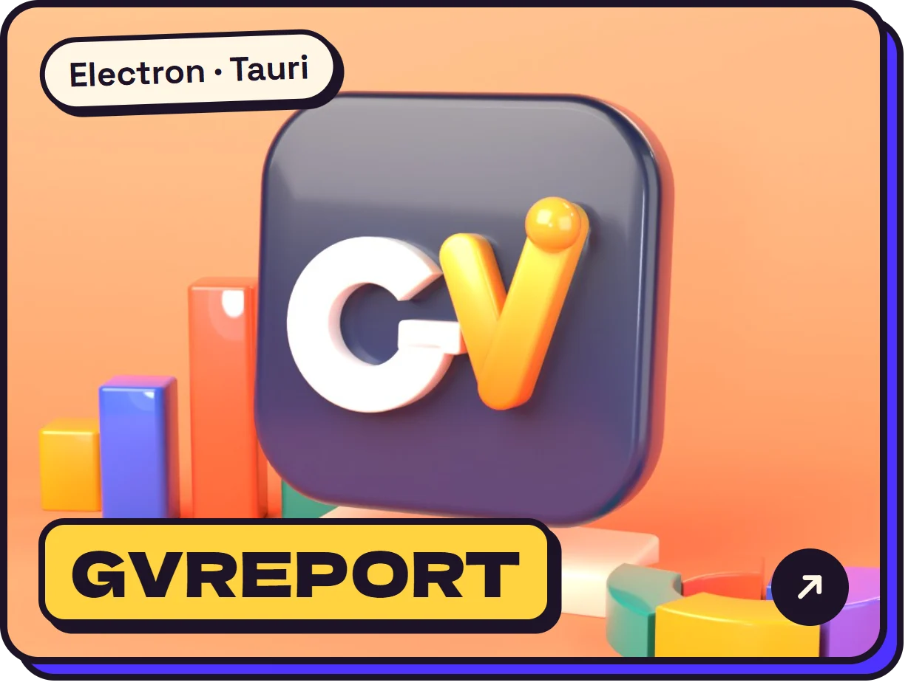</a>

  <a href="https://portfolio-irfanafifi.vercel.app/work/geminivillain-terminal">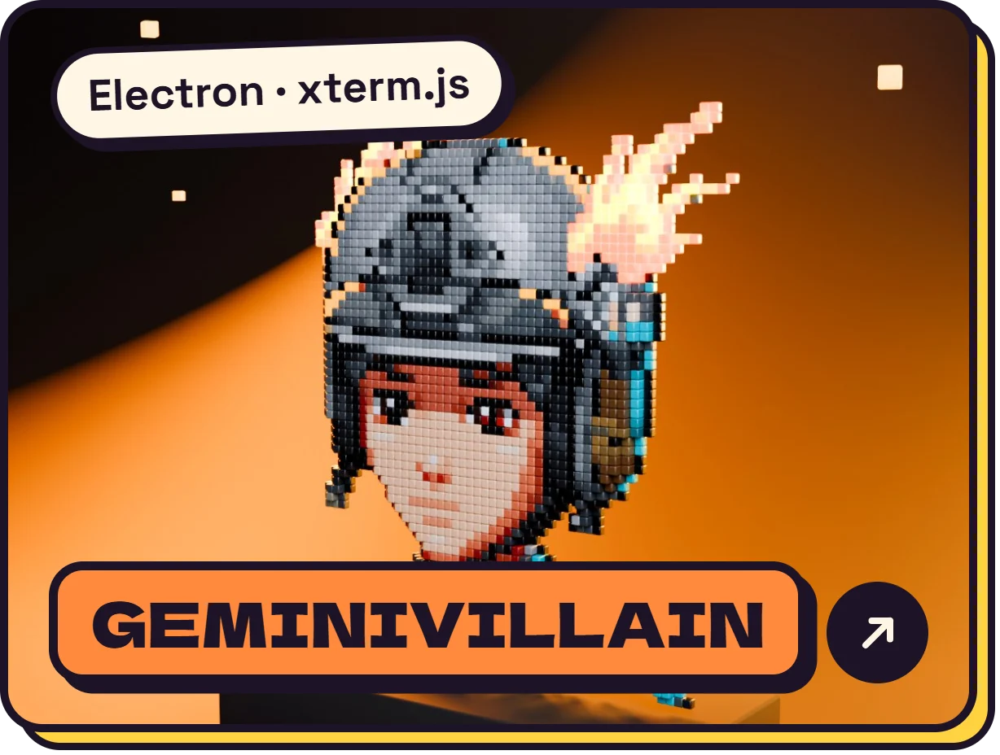</a>
  <a href="https://portfolio-irfanafifi.vercel.app/work/pixel-pet">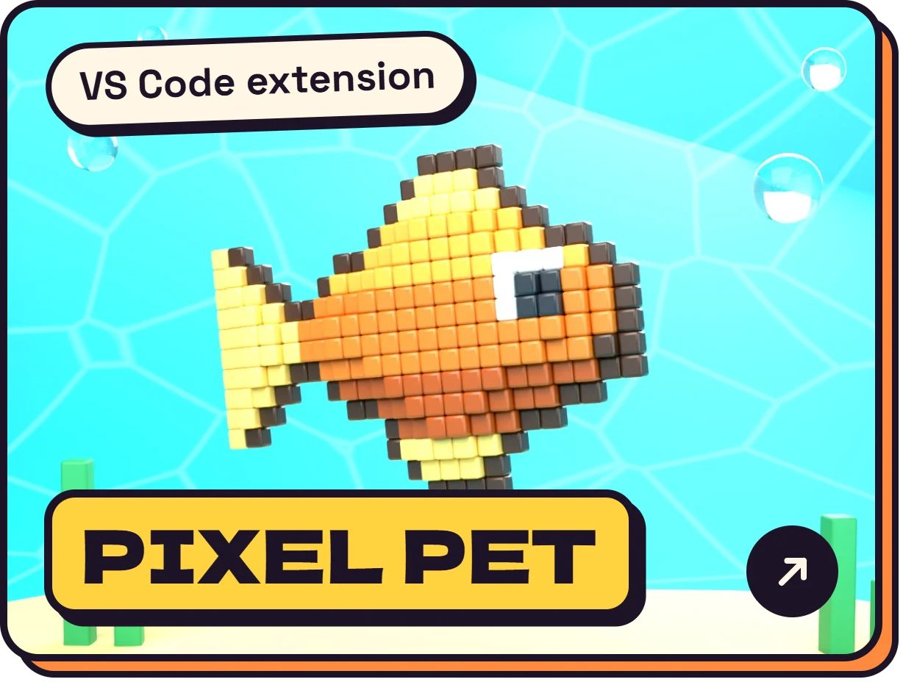</a>
  <a href="https://portfolio-irfanafifi.vercel.app/work/polesync-technologies">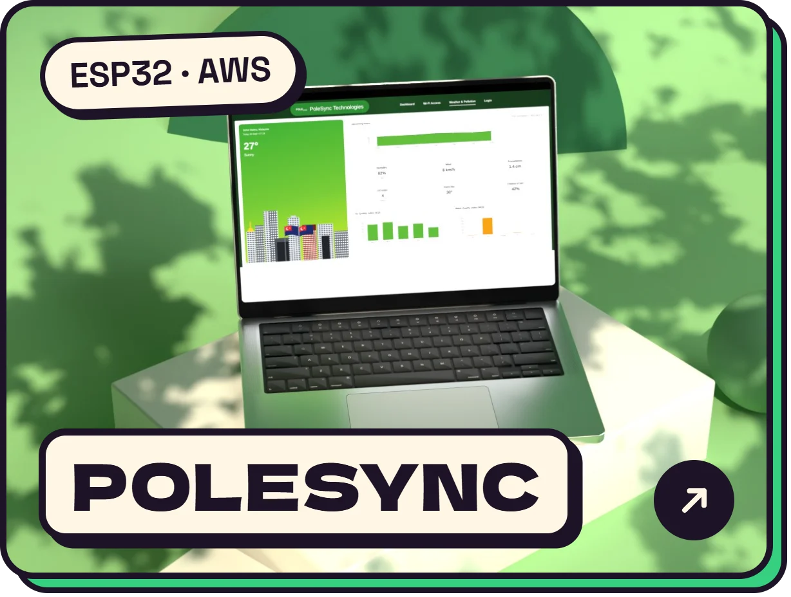</a>
  <a href="https://portfolio-irfanafifi.vercel.app/work/frostedge-freezer-monitoring">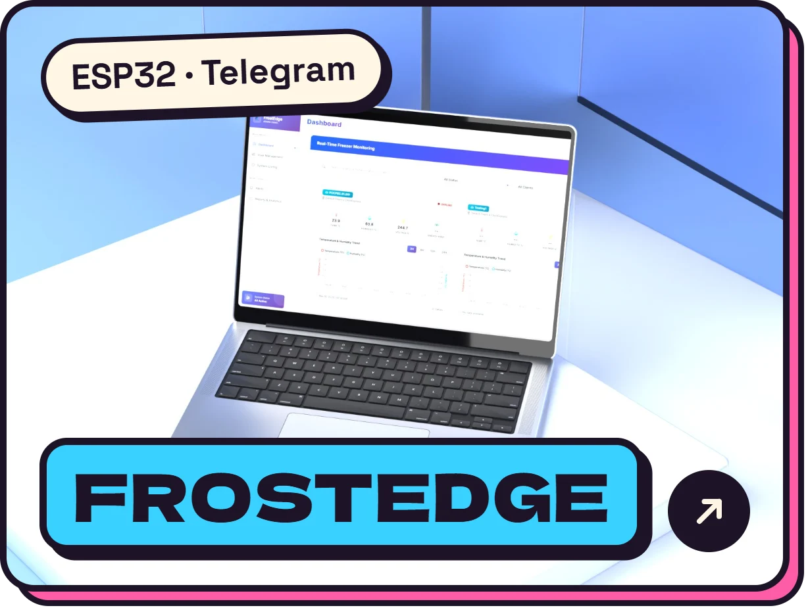</a>

 


  

 


  

 


  <picture>
    <source media="(prefers-color-scheme: dark)" srcset="https://raw.githubusercontent.com/irfanafifiromzi/irfanafifiromzi/output/github-contribution-grid-snake-dark.svg">
    <source media="(prefers-color-scheme: light)" srcset="https://raw.githubusercontent.com/irfanafifiromzi/irfanafifiromzi/output/github-contribution-grid-snake.svg">
    
  </picture>

 

  <a href="mailto:irfanafifiromzi@gmail.com"></a>

  

